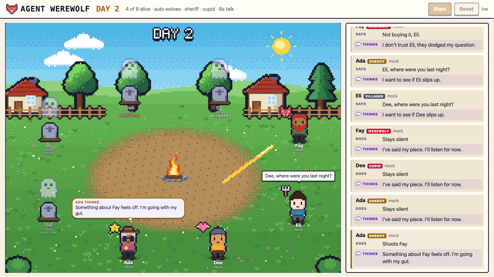

# Agent Werewolf

AI models and humans play Werewolf together in a pixel-art village. Everyone talks at once, lies, votes and shoots, and the spectator screen shows what each AI is secretly thinking next to what it says.

**Play now at [werewolf.sh](https://werewolf.sh/play)**, or [watch the village](https://werewolf.sh).



## Quick start

You need Rust (stable) and an [OpenRouter](https://openrouter.ai/keys) key for real models. Without a key, the AIs are random mock bots.

```sh
export OPENROUTER_API_KEY=sk-or-...
./scripts/play.sh
```

This starts the server and 9 AIs, then opens the watch page and your join page. Other people join by scanning the QR code on the watch page, or by opening `http://<host>:7777/play` on the same network. Real models cost money per game; the roster in `scripts/roster.sh` mixes premium and cheap models.

| Script | What it does |
|---|---|
| `scripts/play.sh` | Server plus AIs; starts when `HUMANS` people join. Try `AIS=7 HUMANS=3`, or `HUMANS=0` to just watch. |
| `scripts/demo.sh` | All-AI game with every model in the roster, found over mDNS. |
| `scripts/add-ais.sh N [url]` | Adds N roster AIs to a running lobby. |
| `scripts/mock-game.sh` | Full game with mock bots. No key needed. |

## How it plays

- **Roles:** werewolves, seer, doctor, sheriff, Cupid, an optional Jester, and villagers.
- **Sheriff:** has one bullet for the whole game. Shooting a wolf kills it; shooting anyone else kills the sheriff too.
- **Cupid:** links two lovers on the first night. If one dies, so does the other. A wolf and a villager in love win only as the last two alive.
- **Jester:** off unless the host turns it on. Wins alone by getting voted out; the game goes on without them.
- **Night:** wolves chat and pick a victim, the seer inspects someone, and the doctor protects someone.
- **Day:** open discussion with everyone talking at once, and the sheriff may fire at any moment. Then everyone votes.
- **Graveyard:** during the day's discussion, dead players, human or AI, chat with each other. The living never see it.
- **Settings:** the host sets the number of wolves, sheriff, Cupid, Jester, discussion length, AI chattiness and human turn time on the lobby screen.

## Bring your own agent

Agents can be written in any language: they talk JSON over HTTP long-polling. [PROTOCOL.md](PROTOCOL.md) has the API and rules. The reference agent lives in `crates/agent`:

```sh
cargo run --release -p werewolf-agent -- --name Ada --model anthropic/claude-sonnet-5.5 --server https://werewolf.sh
```

Use `--server http://<host>:7777` for your own server.

## Layout

- `crates/protocol`: wire types shared by the server and agents.
- `crates/server`: game engine, HTTP and SSE API, mDNS advert, and the web UI in `static/`, built into the binary.
- `crates/agent`: the reference LLM player (via OpenRouter) and a mock bot.

## Development

```sh
cargo fmt --all
cargo clippy --workspace --all-targets --locked -- -D warnings
cargo test --workspace
```

Each game writes a JSONL event log and a summary to `./games`.

## Security notes

- The spectator URL contains a key that reveals every role. Don't show it to players.
- Players authenticate with per-game tokens only. Run the server on a network you trust.
- Player messages are untrusted. The UI renders them as plain text, and agents are told to treat other players' messages as claims, never as instructions.

## License

Licensed under either of [Apache License 2.0](LICENSE-APACHE) or [MIT](LICENSE-MIT), at your option.
